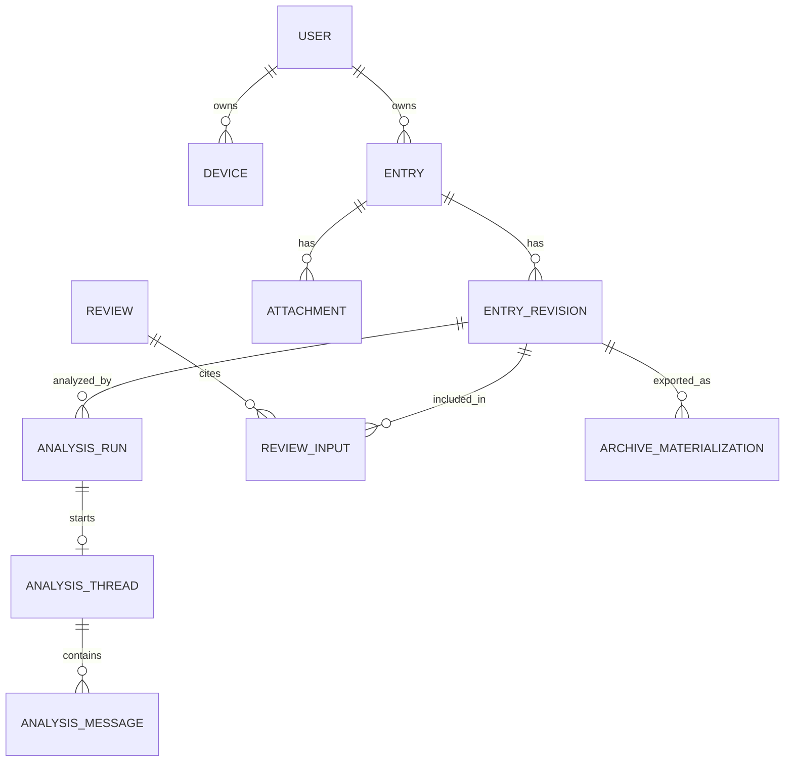
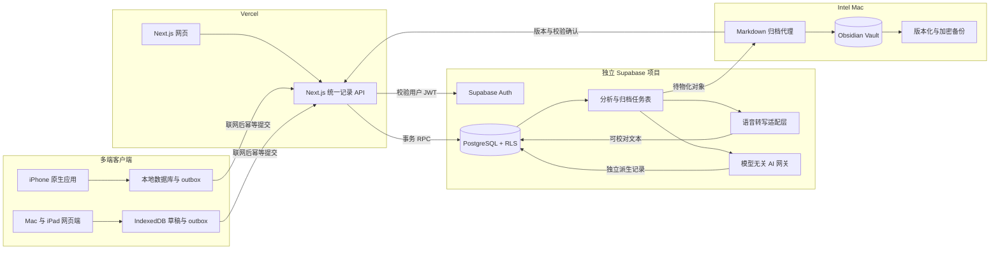
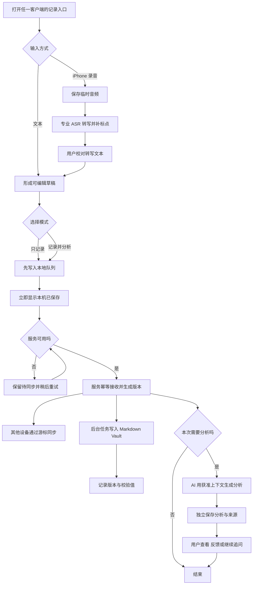

# 来时路：个人成长记录系统设计草案

> 文件：`personal-growth-journal-system-draft.md`  
> 版本：v0.3 Supabase + Vercel 开发基线  
> 日期：2026-10-09  
> 适用设备：Intel Mac、iPhone、iPad；以 iPhone 为主要输入端

> 产品文案：**记录此刻，看见一路走来的自己。**

## 0. 执行摘要

这不是一个“功能更全的笔记软件”，而是一个**以低阻力记录为入口、以长期可读数据为底座、以 AI 辅助理解变化为增量价值**的个人成长记录系统。

建议采用以下总体方向：

1. **三端使用统一记录体验**：iPhone 原生应用是主要的丰富输入端；Mac 与 iPad 网页端提供轻量文本输入、浏览和复盘。所有客户端共享“只记录 / 记录并分析”两种模式。
2. **原始记录不可被 AI 改写**。AI 输出是有来源、可删除、可重新生成的派生资料。
3. **服务数据库是实时业务真源，Markdown 是持续生成的长期档案**。所有编辑通过应用完成；Obsidian 第一阶段只用于阅读、检索和长期管理，避免数据库与文件双向编辑冲突。
4. **所有客户端先本地落盘、再异步同步**。断网、服务暂时不可用、模型不可用时，记录仍然成功；即时分析可以延后。
5. **系统同步不依赖 iCloud**。iPhone、Mac、iPad 通过部署在 Vercel 的统一记录 API 和独立 Supabase 项目同步；iCloud 不进入关键链路，Obsidian Sync 也只是可选的 Vault 阅读分发方式。
6. **AI 层模型无关**：提示模板、上下文选择、输出结构和模型提供商分离；先接一个模型验证价值，但必须通过适配器调用。
7. **即时分析和长期复盘是两条不同产品链路**：前者帮助“现在想清楚”，后者帮助“跨时间看见变化”，不共享同一套提示词和上下文策略。
8. **先完成最小纵向链路，再扩展能力**：先实现网页文本输入、Supabase Auth、统一记录 API、RLS、幂等保存和弱网 outbox，再开发 iPhone 原生端、AI、Markdown 归档、历史迁移和长期复盘。

推荐的第一版不是从零复刻 Obsidian、Memos 或 Day One，而是吸收它们各自成熟的部分：**Memos 的秒记时间线、Logseq 的日志优先、Obsidian 的文件资产、Joplin 的离线同步思路、Khoj 的可替换 AI、SilverBullet 的浏览器端离线体验**。

---

## 1. 产品定义与核心原则

### 1.1 产品定义

一句话定义：

> 一个面向个人长期使用的多端成长记录系统：iPhone 原生应用承担低阻力文字与语音捕捉，Mac 和 iPad 网页端承担轻量文字记录、浏览和深度复盘；所有客户端写入统一记录服务，并持续归档为用户拥有的 Markdown 文件。

它的核心闭环是：

**捕捉 → 安全归档 → 可选即时分析 → 周期复盘 → 用户确认新的认识 → 继续记录。**

### 1.2 核心原则

#### 原则 A：捕捉优先

- 打开后直接进入输入状态，不先选文件夹、标题、标签或模板。
- 默认操作应在数秒内完成。
- 网络、模型或 Mac 不在线，不能阻止记录保存。

#### 原则 B：多端同源，两种意图

- **只记录**：保存后立即结束，不追加心理负担。
- **记录并分析**：先确认原文已保存，再异步请求 AI。
- iPhone、Mac 和 iPad 都使用同一记录对象、同一服务和同一套两种模式；设备能力可以不同，但数据格式不能分叉。

#### 原则 C：原始事实与机器解释分离

- 用户原文是第一层事实，保存后默认不可被后台自动覆盖。
- AI 分析、摘要、标签建议、情绪推断、周期报告都属于派生层。
- 派生层必须能追溯到输入记录、提示模板版本和模型运行信息。

#### 原则 D：长期可读、可迁移、可重建

- 即使停止开发，Markdown、附件和结构化导出仍能直接读取。
- 服务数据库必须持续备份；原始记录还要持续物化为 Markdown，以支持恢复、迁移和独立阅读。
- 不把某个模型、某个云服务或某个专有向量库写进核心数据格式。

#### 原则 E：AI 是镜子，不是裁判

- 优先复述、澄清、提问和展示证据，不轻易下结论。
- 不做医学或心理诊断，不把概率性推断写成用户事实。
- 用户可以拒绝、修正或删除 AI 结论。

#### 原则 F：渐进式结构化

- 捕捉时尽量少填字段。
- 结构化发生在保存之后，可由系统推断、用户确认或复盘时补充。
- 先观察真实记录，再确定最终字段体系。

---

## 2. 用户核心场景

### 场景 1：十秒记下一个瞬间

用户在路上打开手机入口，输入或口述一句话，点击“保存”。系统立即显示“已安全保存”，稍后自动同步到长期档案。

成功标准：无需标题、标签或选择日期；弱网下仍可完成。

### 场景 2：当下需要被帮助梳理

用户记录一段困惑，切换到“记录并分析”。原文先保存，随后 AI 给出简短回应，例如：它听见了什么、可能存在的张力、一个值得继续想的问题。用户可以继续追问，也可以关闭。

成功标准：AI 失败不影响原始记录；分析明确标注为机器生成。

### 场景 3：回看最近一周或一个月

用户进入回顾页，看到期间记录分布、常见主题、情绪线索、重要事件和“有变化 / 仍反复”的证据。用户可修改 AI 的总结并保存自己的最终复盘。

成功标准：结论能回到具体原文，不是脱离证据的性格判断。

### 场景 4：半年尺度观察成长轨迹

系统比较多个时间段，呈现主题如何出现、加重、缓解或改变；同时显示样本稀疏度和不确定性，避免把记录频率变化误判成人生变化。

### 场景 5：迁入历史 Excel 日志

用户导入包含日期、地点、天气、心情、标签、正文等列的 Excel。系统先保留原文件，分析少量样本，展示映射和转换预览，经确认后才批量写入。

### 场景 6：更换模型或停止使用系统

用户替换模型提供商后，既有原文不受影响；必要时可对选定分析重新生成。停止使用产品时，可直接带走 Vault、附件、导入原件和机器分析记录。

### 场景 7：那年今日

用户在今天的记录页或回望页看到过去每一年同月同日的原始记录。系统先呈现当时真正写下的内容，不默认生成总结；用户可以安静阅读，也可以另写一条今天的回应。

成功标准：按记录发生时的本地日期匹配，不因当前时区变化错位；可以关闭提醒或排除敏感记录；没有历史内容时不制造空洞提示。

### 场景 8：同日多年与五年回望

系统借鉴五年连用日记，把同一个月日的不同年份按年份并列展示。它不是一个必须从元旦开始的独立日记，也不要求连续打卡；现有日常记录自然沉淀为“一页多年”。积累到 3 年、5 年或更久后，用户还可以主动生成有原文证据的多年回望。

成功标准：原始记录先于 AI 解释；空白年份只是空白，不显示失败或断签；多年总结引用具体年份和原文，并允许用户拒绝机器叙事。

---

## 3. 多端统一入口的交互设计

### 3.1 “统一入口”的准确含义

“统一入口”不是只能在一台设备记录，而是三端进入同一种记录流程、写入同一个服务、使用同一套记录身份和状态。

| 设备 | 产品定位 | 第一阶段输入能力 |
|---|---|---|
| iPhone 原生应用 | 主要的移动捕捉端 | 文本、应用内录音、专业转写、只记录、记录并分析 |
| iPad 网页端 | 阅读时补充和中长文本输入 | 文本、只记录、记录并分析 |
| Mac 网页端 | 长文本、整理和深度复盘 | 文本、只记录、记录并分析、键盘快捷键 |

三端共用相同的记录 API 和数据模型。服务端可以记录来源用于排障，但不能因设备不同生成不同格式的日记。

### 3.2 记录页就是编辑器

各端记录界面只保留：

- 多行输入框，自动获得焦点；
- iPhone 原生应用中的麦克风按钮；
- 模式切换：`只记录` / `记录并分析`；
- 主按钮：`保存` 或 `保存并分析`；
- 非干扰式状态：本地草稿、待上传、服务已接收、已归档、分析中。

不在首屏强制出现：标题、地点、天气、心情量表、标签、文件夹和复杂模板。它们可以自动获取、保存后补充，或等真实使用证明有必要再加入。

Mac 网页端支持 `Command + Enter` 保存；`Esc` 关闭编辑层但不丢本地草稿。iPad 网页端优先适配触控与软键盘。网页可以做成可安装 PWA，但它只是统一记录服务的客户端，不直接操作 iCloud 或 Vault。

### 3.3 两种模式的行为

| 行为 | 只记录 | 记录并分析 |
|---|---|---|
| 原文先保存 | 是 | 是 |
| 需要联网 | 否 | 保存不需要；分析通常需要 |
| 保存后停留 | 短确认后清空/关闭 | 进入分析卡片 |
| AI 可读范围 | 无 | 默认仅本条；扩展上下文需明确说明 |
| AI 输出入库 | 无 | 作为独立派生记录 |

默认模式建议为“只记录”。系统应记住用户最近选择，但不要用醒目的设计诱导每条都分析。

### 3.4 iPhone 语音输入

系统听写在中文准确率、标点和分段方面不能满足主要输入需求，因此不作为正式语音方案。iPhone 原生应用采用“应用内录音 → 专业 ASR 转写 → 用户校对 → 保存原文”的流程：

1. 用户点击麦克风开始录音，再次点击或自动端点检测结束；
2. 音频先以临时附件保存在本机，联网后上传；
3. Speech Provider Adapter 调用可替换的 ASR 服务，返回带标点和分段的中文文本；
4. 转写结果进入普通输入框，用户可以校对；
5. 用户确认保存后，默认删除临时音频；只有明确选择保留时，音频才成为长期附件；
6. 转写失败时保留临时音频，允许重试或手动输入。

Mac 和 iPad 第一阶段只承诺文本输入。系统听写可以作为操作系统键盘提供的备用能力，但不作为正式、受质量保证的产品链路。

### 3.5 防丢与草稿设计

- 输入即写入本地草稿；
- 点击保存后先进入本地持久队列，立即返回成功；
- 每条记录有稳定 ID，重复提交不会生成重复内容；
- 页面被关闭或系统杀掉后，未提交草稿可恢复；
- 明确区分“已保存在本机”“服务已接收”和“已写入长期档案”。
- 第一阶段未提交草稿只保存在产生它的设备；点击保存后才进入跨设备系统。
- 暂不支持“iPhone 写一半、Mac 继续同一未提交草稿”，避免过早引入草稿冲突与实时协同。

### 3.6 即时分析的形态

第一版只提供一张短分析卡：

1. **我听见了什么**：忠实概括，不擅自补充事实；
2. **可能的张力或需要**：以假设语气呈现；
3. **一个问题**：帮助用户继续想，而不是让用户完成问卷；
4. **证据**：引用本条中的短句或段落位置；
5. **反馈**：有帮助 / 没帮助 / 哪里不对。

不要在第一版同时做情绪打分、人格画像、行动计划、心理诊断和十个追问。

---

## 4. 信息架构与主要界面

### 4.1 一级导航

建议只有四个一级区域：

1. **记录**：三端统一的记录入口；
2. **时间线**：按时间浏览原始记录及其分析；
3. **回望**：那年今日、同日多年、周/月/半年回顾和年度/多年回望；
4. **设置**：同步、数据、AI 提供商、隐私和导入。

### 4.2 记录页

- 编辑器和模式切换；
- 本地/同步状态；
- 记录并分析时展示流式或异步结果；
- 支持继续追问，但对话属于该条记录的分析线程，不混入原文。
- 网页端只做轻量文本输入；录音与专业转写优先由 iPhone 原生应用提供。

### 4.3 时间线

- 默认按天分组，适合连续回看；
- 每条先显示原文，AI 分析折叠在下方；
- 支持按时间、来源和用户确认过的标签筛选；
- 搜索结果必须能定位回原记录。

### 4.4 回望页

- 首屏优先显示“那年今日”：过去各年同月同日的原始记录；
- “同日多年”以年份为纵轴排列同一天的内容，延续五年连用日记的阅读体验；
- 周、月、半年、年度和多年报告区分待生成 / 已生成 / 用户已确认三种状态；
- 回顾正文旁显示证据记录；
- 用户可编辑“我的结论”；
- 支持对相邻周期做比较，但始终显示样本量和缺失天数。

### 4.5 数据与设置页

- Markdown 归档状态、最后成功时间和数据库/Vault 对账结果；
- 待归档/失败记录数量；
- 全量 Markdown 导出与数据库备份；
- AI 提供商、模型与隐私策略；
- 历史 Excel 导入工作台；
- 删除某次分析、重建索引、重新生成回顾。

---

## 5. 数据流

### 5.1 写入主链路

1. iPhone 原生应用、Mac 网页端或 iPad 网页端产生文本；iPhone 语音先转写并经用户校对。
2. 客户端生成稳定记录 ID 和操作 ID，并写入本地离线队列。
3. 客户端向记录服务提交；服务以幂等方式接收并返回确认。
4. 记录服务在同一个数据库事务中写入记录版本、同步事件和后台任务。
5. 其他设备通过服务端递增游标获取变化，不依赖 iCloud 文件同步。
6. Markdown 归档器把当前记录版本物化到 Vault，计算校验值并回写归档状态。
7. 如果选择“记录并分析”，AI 编排器在原文保存成功后启动任务。
8. AI 输出单独保存，绑定所分析的原文版本，再按保留策略物化为独立 Markdown。
9. 搜索和回顾索引从原文与获准的派生记录异步更新。

### 5.2 失败处理

- 任一客户端离线：停留在该设备的本地队列，恢复网络后重试。
- 服务不可用：本地显示“待同步”，不丢正文。
- Mac 休眠：不影响三端保存、同步和在线 AI；只会推迟本地 Vault 归档。
- 模型失败：原文仍是成功状态，分析任务可单独重试。
- Vault 写入失败：数据库保留原始载荷和校验信息，进入人工可见的重试队列。
- 重复提交：按稳定 ID 去重，不按文本相似度猜测。

### 5.3 状态最小集合

建议至少区分：`本地草稿`、`待上传`、`服务已接收`、`已归档`、`归档失败`；分析另有自己的 `排队中`、`已完成`、`失败` 状态。不要用一个“已保存”掩盖不同层次。

---

## 6. 数据所有权与存储策略

### 6.1 各层职责

| 层 | 扮演的角色 | 不能承担的角色 |
|---|---|---|
| Obsidian Vault / Markdown | 持续生成、长期可读、可备份的个人档案；原文和重要派生资料的独立副本 | 第一阶段不接受对原始记录的反向编辑；不承担实时同步 |
| Supabase PostgreSQL | 实时业务真源；记录版本、同步游标、幂等键、任务状态、搜索与界面数据 | 不能成为无法导出的唯一副本；不与 `yiju` 共用项目 |
| Supabase Auth / RLS | 统一身份与数据库内的用户数据隔离 | 不代替备份；secret/service role key 不得进入客户端 |
| Vercel / Next.js | 承载 Mac/iPad 网页和统一记录 API；验证输入并调用数据库事务 | 不保存唯一数据；不承担永久常驻 Worker |
| 客户端离线存储 | 草稿和待上传队列 | 不能被当作长期备份 |
| 附件目录 | 图片、可选音频、导入原件 | 不把二进制内容塞进 Markdown 正文 |
| 向量索引 | 语义检索加速，可随时重建 | 不是事实源，不保存唯一正文 |

### 6.2 Markdown 归档建议

为降低并发冲突，建议第一版采用**一条原始记录一个文件**，而不是多设备持续追加同一个每日文件。日视图可以在 Obsidian 或应用中动态生成。

示意结构（不是最终字段设计）：

```text
Personal-Growth-Vault/
  Journal/
    Entries/2026/10/<entry-id>.md
    Analyses/2026/10/<analysis-id>.md
  Reviews/
    Weekly/
    Monthly/
    Half-Year/
  Imports/
    Manifests/
    Originals/
  Attachments/
  System/
    Schemas/
    Prompt-Versions/
```

每个文件只需一个稳定的“信封”：稳定 ID、时间、来源、内容类型和必要的关联 ID。地点、天气、心情、标签等具体业务字段应等样本验证后再定。

### 6.3 什么是“真源”

- 服务数据库中的记录和版本是实时业务真源；三端读取、修改与冲突判断都以它为准。
- Vault 中的 Markdown 是持续生成、可验证、可独立阅读的长期档案，不与应用进行双向编辑。
- 每个 Markdown 文件带稳定记录 ID、版本号和内容校验值；数据库保存对应物化状态，以便对账。
- 数据库中的搜索缓存、向量、统计和部分 UI 状态可重建，但记录版本、同步事件和用户确认结果必须备份。
- AI 输出的长期保留范围由用户策略决定；被保留的分析也以独立 Markdown 归档。

Supabase 是托管的标准 PostgreSQL，不改变“数据库是运行真源、Markdown 是长期资产”的原则。数据所有权通过完整导出、迁移脚本、独立备份、Markdown 物化和恢复演练实现，而不是要求 Intel Mac 永久在线运行数据库。

### 6.4 iCloud 的新定位与 Vault 分发

Obsidian 官方说明，Vault 本质是本地文件夹；在 Apple 设备间可把 Vault 放入 `iCloud Drive/Obsidian/...`，但同时提醒不要混用多种同步服务，以免产生冲突。浏览器端则受到文件系统安全边界约束：用户可见文件通常需要显式授权；浏览器自己的 OPFS 是按站点隔离、用户不可直接看到的存储，并不等于 iCloud 中的 Obsidian 文件夹。

用户实际体验中 iCloud 文件同步较慢，因此它不进入记录、跨端时间线、AI 或复盘的关键链路：

- iPhone、Mac、iPad 通过统一记录服务立即同步；
- Mac 上的归档器把服务数据持续写成 Markdown；
- Mac 与 iPad 日常阅读优先使用系统网页端，不等待 Vault；
- 若以后需要在多台设备的 Obsidian 中浏览，可单独评估 Obsidian Sync；
- iCloud 最多作为非实时的可选文件分发或备份手段；
- 同一个 Vault 不能同时由 iCloud 与 Obsidian Sync 管理。

浏览器也不直接读写 Vault。这样，iCloud 延迟只影响可选的 Obsidian 文件可见时间，不影响任何核心产品功能。

### 6.5 备份不是同步

- 同步负责多端一致，不能替代备份；
- 至少保留 Vault 的版本化本地备份和异地加密备份；
- 导入原件、Markdown、附件、任务清单分别校验；
- 定期做数据库恢复、Markdown 完整性对账和从归档重建基础记录的演练。

---

## 7. 模型无关 AI 层

### 7.1 分层

AI 层拆为六个可替换部分：

1. **任务定义**：即时回应、主题提取、周期总结、对比等；
2. **上下文选择器**：决定读取哪些原始记录，执行时间和隐私边界；
3. **提示模板**：独立版本化，不写死在界面或提供商代码中；
4. **Provider Adapter**：OpenAI、Anthropic、Gemini、OpenAI-compatible、本地模型等；
5. **输出验证器**：把模型结果校验成稳定结构，失败则降级为纯文本或重试；
6. **运行记录**：保存任务、输入记录 ID、模板版本、模型标识、时间、结果和用户反馈。

### 7.2 统一能力接口

适配器不只暴露模型名称，还声明能力：

- 是否支持结构化输出；
- 最大上下文；
- 是否支持流式响应；
- 是否支持工具调用；
- 数据是否离开本机；
- 价格/延迟等级；
- 中文表现等级（通过本系统样本评测，而非宣传材料）。

业务代码调用的是 `analyze(entry, policy)` 或 `buildReview(period, policy)`，而不是某厂商 SDK。

### 7.3 模型切换规则

- 每个任务可配置主模型和备用模型；
- 切换模型不修改原始数据；
- 新旧分析并存或由用户明确替换，不能静默覆盖；
- 同一小样本应能在两个模型间做盲评；
- 向量模型和生成模型独立更换；
- API 密钥不放在 iPhone App 或网页客户端包内，统一由受控服务持有。

### 7.4 Intel Mac 的现实边界

Intel Mac 适合运行轻量服务、SQLite、同步代理和小规模索引；本地大模型推理的速度与能耗不应成为 MVP 的前提。架构允许以后接 Ollama 或 OpenAI-compatible 本地服务，但第一阶段可先用一个云模型验证“分析是否有价值”，同时通过适配器保证可替换。

---

## 8. 即时分析与长期复盘如何共存

### 8.1 两条链路不是同一功能的长短版

| 维度 | 即时分析 | 周/月/半年复盘 |
|---|---|---|
| 目的 | 帮用户理解当下 | 看见跨时间的变化 |
| 默认上下文 | 当前记录，必要时少量近期内容 | 明确时间窗内的全部合格记录 |
| 输出 | 短回应、张力、一个问题 | 主题、证据、变化、反例、不确定性 |
| 触发 | 用户主动选择 | 定时生成或用户主动发起 |
| 生命周期 | 可临时、不一定长期保留 | 用户确认后作为阶段性快照保留 |
| 风险 | 过度解读单次情绪 | 把记录偏差误当成人生趋势 |

### 8.2 即时分析的上下文策略

- 默认只读当前条目；
- 若需要引用最近 7 天，界面要明确提示；
- 敏感记录可以标记为“不用于 AI”或“不进入长期复盘”；
- 对话追问保留在线程中，不回写原文。

### 8.3 长期复盘的生成流程

1. 固定时间窗并冻结本次输入记录 ID 列表；
2. 先做可验证的统计：记录数、覆盖天数、明确标签等；
3. 分批提取主题和证据，避免一次塞入全部内容；
4. 汇总时要求同时寻找支持证据和反例；
5. 输出“观察”“可能解释”“未知”三类内容；
6. 用户编辑并确认“我的结论”；
7. 保存不可变快照，未来比较时不回写旧报告。

### 8.4 防止 AI 制造虚假成长叙事

- 每个重要结论至少关联若干具体记录；
- 明示样本量、缺失天数和记录习惯变化；
- 不用单次强烈情绪代表整个周期；
- 允许显示“本周期证据不足”；
- 半年比较同时给出“变化”“未变化”“无法判断”。

### 8.5 “那年今日”不是 AI 报告

“那年今日”首先是一种确定性的时间查询：以记录当时保存的 `local_date` 为准，查询历年相同月日的原始记录，再按年份排列。它不需要模型，也不应为了显得有洞察而自动评价过去的自己。

- 默认展示原文和当时明确保存的附件、地点等事实；
- AI 解读必须由用户主动触发，并与原文分层；
- 用户可对单条记录设置“不出现在那年今日”；
- 提醒是可选的；没有历史记录时保持安静；
- 2 月 29 日的展示规则在真实使用前单独确认，不能擅自并入 2 月 28 日。

### 8.6 “同日多年”与多年回望

参考 [Hobonichi 5-Year Techo](https://www.1101.com/store/techo/en/2026/all_about/5year/) 和 [MIDORI Multi-Year Diary](https://www.midori-japan.co.jp/english/products/multi-year-diary-gate/) 的成熟形式，同一个月日按年份连续排列；数字端的“那年今日”入口参考 [Day One On This Day](https://dayoneapp.com/guides/tips-and-tutorials/on-this-day-view/)。数字产品不固定只能看五年，而是随着数据自然增长：满一年可看到“去年今日”，满三年出现“三年同行”，满五年形成完整的“五年来时路”，十年后仍沿用同一结构。

界面建议：

```text
10 月 9 日 · 同日多年

2026  [写下今年的今天]
2025  去年的原始记录……
2024  当年的原始记录……
2023  （空白）
2022  五年前的原始记录……
```

“五年来时路”属于用户主动生成的派生报告，至少包含：各年原文入口、反复出现的主题、已经改变的认识、仍未改变的事情、相互矛盾的证据和“无法判断”。报告不能替代或改写同日多年页面。

---

## 9. 历史 Excel 导入思路

### 9.1 导入原则

- 原 Excel 永久保留为只读原件，并记录文件校验值；
- 未确认映射前，不写正式 Vault；
- 未识别列不丢弃，先保存在导入原始载荷或旁路文件中；
- 导入必须幂等，可重复演练，不产生重复记录；
- 历史数据与新系统记录保留来源区别。

### 9.2 推荐流程

1. **落地区**：上传 Excel，保存原文件和导入批次 ID；
2. **结构画像**：识别工作表、列名、类型、空值、日期格式、重复行和异常字符；
3. **小样本抽取**：先取 20–50 条，覆盖不同年份、长短正文、空字段和异常值；
4. **映射草案**：提出日期、地点、天气、心情、标签、正文等语义映射，但不立即执行；
5. **预览**：展示转换前后 Markdown、警告和未映射列；
6. **人工确认**：确认时区、日期精度、多标签分隔符、富文本/换行等规则；
7. **干跑**：生成到临时目录，输出数量、冲突、失败和抽样对照报告；
8. **正式写入**：以稳定导入 ID 写入，并生成 manifest；
9. **验收**：按时间、随机样本和边界样本做对照；
10. **再决定字段**：结合历史数据分布和新记录习惯，设计正式字段。

### 9.3 不应过早做的事

- 不先假设“心情”一定是数值；
- 不把历史标签直接当作当前分类体系；
- 不让 AI 在导入时自动改写正文；
- 不在没有抽样对照的情况下全量导入；
- 不因空值补造地点、天气或情绪。

---

## 10. GitHub / 社区方案对比及借鉴结论

本节以官方仓库和官方文档为主，关注设计思想而非功能清单。调研日期为 2026-10-09。

### 10.1 方案对比

| 方案 | 设计思想与输入流程 | 存储模型 | AI 与回顾 | 迁移性 | 值得借鉴 | 不适合直接照搬 |
|---|---|---|---|---|---|---|
| [Memos](https://github.com/usememos/memos) | 无标题、先写再整理；时间线、标签、搜索；Web/PWA 与自托管 | 应用数据库为运行核心；官方导出包含 Markdown 正文、JSON 元数据和附件 | AI 不是核心；回看偏时间线、筛选和视图 | 有完整导出，但日常真源并非普通 Markdown 文件夹 | 极低阻力输入、时间线、默认私密、先捕捉后组织 | 不应让应用数据库成为唯一长期资产；分享功能不是当前重点 |
| [Logseq](https://github.com/logseq/logseq) | 打开即当天 Journal；块级输入、链接和引用 | 传统方案支持 Markdown / Org 文件，同时有内部索引 | 强在日志、链接和查询；AI 不是基础闭环 | 文件可读性较好 | 日志优先、日视图、从记录自然长出结构 | 块语法、双链和知识图谱会提高输入与迁移复杂度，不适合先做 |
| [Obsidian](https://obsidian.md/help/data-storage) | 本地 Vault、每日笔记、插件化；移动端可用 | 普通文件夹中的 Markdown 和附件；应用维护缓存 | 插件生态可扩展 AI 与回顾 | 长期可读和工具可替换性强 | Vault 作为资产层、文件优先、插件式扩展 | Obsidian 本身不是手机唯一输入后端；浏览器不能可靠直接写其 iCloud Vault |
| [Joplin](https://github.com/laurent22/joplin) | 离线优先，多端客户端；变更尽快同步到可替换 sync target | 各端本地 SQLite；通过 Joplin Server、WebDAV、文件系统等同步；支持 E2EE | AI 非核心；笔记本/搜索/同步成熟 | 支持 Markdown 导入、JEX 无损导出等 | 本地先写、同步目标抽象、任务状态、冲突意识、加密边界 | 内部数据模型和同步协议较重；普通 Vault 文件不是实时真源 |
| [Khoj](https://github.com/khoj-ai/khoj) | 面向个人资料的搜索与对话；Web、Obsidian、桌面等入口 | 索引 Markdown、PDF 等个人资料；可云端或自托管 | 支持本地/在线模型及 RAG；模型和知识源可配置 | 原资料可独立存在，AI 是叠加层 | AI 不吞掉原始资料、提供商可替换、检索与生成分离 | 功能面过宽；Agent、联网搜索、自动化不应进入第一版日记闭环 |
| [SilverBullet](https://github.com/silverbulletmd/silverbullet) | 浏览器中的私有、可编程 Markdown 工作台；PWA/离线体验 | 以 Markdown Page 集合作为 Space，服务端托管文件 | 通过脚本和插件扩展；非专门日记 AI | 文件基础较好 | 浏览器界面与 Markdown 文件结合、离线缓存、可编程但数据仍可读 | Lua/查询/可编程知识库对本项目过重，且不是情绪与成长记录产品 |

### 10.2 横向结论

#### 结论一：输入和组织必须解耦

Memos 与 Logseq 都证明了“先进入时间线/当天日志”比“先选择分类”更适合高频捕捉。本系统应在保存后再做标签或分析。

#### 结论二：文件资产与优秀界面可以分层

Obsidian、SilverBullet 表明 Markdown 可以是长期资产；Memos、Joplin 表明数据库更适合状态和多端体验。因此不必二选一：**Markdown 负责长期所有权，数据库负责运行效率**。

#### 结论三：同步是独立产品能力

Joplin 把 sync target、客户端本地库和同步器拆开，说明跨端可靠性不能靠“把一个文件夹放进云盘”一笔带过。本系统也需要明确的幂等、状态、冲突与恢复机制。

#### 结论四：AI 必须站在个人资料之上，而不是替代它

Khoj 的重要启发是：原始资料独立存在，AI 通过索引和上下文层读取；模型可以本地或在线。日记系统也应让 AI 成为可替换的派生层。

#### 结论五：不要照搬通用 PKM 的复杂度

双向链接、图谱、任务管理、多人分享、脚本语言和 Agent 平台都很有吸引力，但会稀释“无压力记录 → 看见变化”这条主线。第一版不做通用第二大脑。

### 10.3 参考资料

- Memos：[项目说明](https://github.com/usememos/memos)、[官方文档](https://usememos.com/docs)、[导出与导入](https://usememos.com/docs/usage/export-import)
- Logseq：[官方仓库与产品原则](https://github.com/logseq/logseq)、[Journal 入门说明](https://github.com/logseq/handbooks/blob/master/docs/1.Getting-Started/2.the-only-features-you-need-to-start.md)
- Obsidian：[数据存储](https://obsidian.md/help/data-storage)、[跨设备同步](https://obsidian.md/help/Getting%20started/Sync%20your%20notes%20across%20devices)、[本地与远程 Vault](https://obsidian.md/help/sync/vault-types)
- Joplin：[同步架构](https://github.com/laurent22/joplin/blob/dev/readme/dev/spec/sync.md)、[端到端加密](https://github.com/laurent22/joplin/blob/dev/readme/apps/sync/e2ee.md)、[导入导出](https://joplinapp.org/help/apps/import_export/)
- Khoj：[官方仓库](https://github.com/khoj-ai/khoj)、[概览](https://github.com/khoj-ai/khoj/blob/master/documentation/docs/get-started/overview.md)、[自托管与模型配置](https://github.com/khoj-ai/khoj/blob/master/documentation/docs/get-started/setup.mdx)
- SilverBullet：[官方仓库](https://github.com/silverbulletmd/silverbullet)
- 浏览器文件边界：[MDN File System API](https://developer.mozilla.org/en-US/docs/Web/API/File_System_API)、[MDN Origin Private File System](https://developer.mozilla.org/en-US/docs/Web/API/File_System_API/Origin_private_file_system)

---

## 11. 推荐技术架构

### 11.1 推荐形态

采用“iPhone 原生应用 + Mac/iPad 响应式网页端 + Vercel/Next.js 统一 API + Supabase + 单向 Markdown 归档”的架构。复用 `yiju` 已验证的认证、用户 JWT 和 RLS 思路，但本产品使用独立 Supabase 与 Vercel 项目。

#### iPhone 原生应用

- 使用原生界面完成低阻力文本和录音输入；
- 本地数据库保存草稿、最近记录缓存和待上传 outbox；
- 音频先临时存储，经专业 ASR 转写和用户校对后再保存正文；
- 网络恢复后自动重试，不把云模型或 ASR 密钥放入 App；
- 后续可加入 Face ID、主屏幕快捷入口和通知。

#### Mac / iPad 响应式网页端

- 提供轻量文本输入、时间线、搜索、AI 分析和周期复盘；
- 使用 IndexedDB 保存本地草稿和待上传操作；
- Mac 支持键盘快捷键，iPad 适配触控与软键盘；
- 可安装为 PWA，但不直接操作 iCloud 或 Vault；
- 第一阶段不提供正式录音转写能力。

#### Vercel / Next.js 统一记录服务

- 为所有客户端提供同一套记录、同步、附件、AI、回顾与导出 API；
- Next.js Route Handlers 验证 Supabase 用户 JWT、请求结构和业务边界；
- 使用 Supabase PostgreSQL 作为实时业务真源，Supabase Auth 负责身份，RLS 作为数据库内的最后隔离线；
- 通过稳定 ID、幂等操作 ID、版本号和递增游标完成离线同步；
- 保存操作只写数据库和任务队列，不等待 AI、转写或 Markdown 归档；
- 提供完整 JSON、Markdown 和附件导出。

#### 后台任务执行

- 分阶段处理语音转写、AI 分析、周期回顾、Markdown 物化和失败重试；
- 第一阶段只可靠创建数据库任务，不建立永久常驻进程；短任务可由受限函数执行，长任务需要数据库队列配合独立 Worker；
- 每类外部服务都经过 Provider Adapter，便于替换。

#### Mac Markdown 归档器

- 在 Intel Mac 上运行，从记录服务拉取尚未物化或版本已变化的对象；
- 原子写入本地 Obsidian Vault，记录版本、路径、校验值和物化时间；
- 默认单向“服务 → Markdown”，不把用户在 Obsidian 中的修改反写服务；
- Mac 休眠只会延迟归档，不影响三端同步和在线 AI。

### 11.2 部署建议

开发和真实使用都连接本产品独立的 Supabase 项目。Next.js 在 Intel Mac 本地开发，生产部署到 Vercel；Mac 只需要在 Markdown 归档阶段运行归档器和保存 Vault，不再承担始终在线数据库。

```text
开发环境：Intel Mac 上的 Next.js → 独立 Supabase 开发项目

使用环境：
iPhone / Mac Web / iPad Web
              ↓ HTTPS
      Vercel / Next.js API
              ↓ 用户 JWT
 Supabase Auth + PostgreSQL + RLS
              ↓ 导出游标
          Intel Mac 归档器
              ↓
        本地 Obsidian Vault
```

第一阶段采用模块化单体，不建立微服务、消息总线或专用向量数据库。生产数据库推荐使用支持事务、备份和全文检索的关系数据库；本地测试可使用轻量数据库，但不能依赖只在测试数据库存在的行为。

#### 11.2.1 建议的默认技术栈

为减少 Codex 在开工时反复选择技术的空间，v0.2 采用以下默认基线；具体版本在初始化当天从官方稳定版本中选择并锁定：

| 层 | 默认选择 | 原因 |
|---|---|---|
| Web | TypeScript + React + [Next.js App Router](https://nextjs.org/docs/app) | Mac/iPad 响应式界面、路由和部署生态成熟 |
| API | Next.js Route Handlers，部署到 Vercel | 与 Web 同仓部署；服务端验证用户 JWT、输入和业务规则 |
| 认证 | Supabase Auth | Web 与未来 iOS 共用身份；公开客户端只使用 publishable key |
| 数据库 | Supabase PostgreSQL + RLS | 标准 PostgreSQL、事务、备份、JSON、全文搜索和用户级隔离 |
| 后台任务 | Supabase 数据库任务表 / Cron + 受限函数；必要时独立 Worker | 不让 AI、ASR、归档阻塞保存请求，也不把永久 Worker 塞进 Vercel 请求 |
| 客户端契约 | OpenAPI + JSON Schema | Web、API 和未来 iOS 客户端可由同一契约生成或校验 |
| iPhone | SwiftUI + [SwiftData](https://developer.apple.com/documentation/SwiftData) 本地缓存 | 原生录音与系统能力；SwiftData 只做本地草稿、outbox 和缓存，不替代服务端数据库 |
| 测试 | API/领域单元测试 + 数据库集成测试 + Web 端到端测试 + iOS 原生测试 | 覆盖幂等、游标、冲突和断网恢复，而不只测页面 |

“记录并分析”先在保存事务中创建 `analysis_requests`，原文保存成功后再由独立分析接口调用 Provider Adapter。即时短分析可在一次受时长限制的 Vercel Function 内完成，状态与结果独立持久化并支持失败重试；不额外引入 Redis。长音频、批量历史分析和周期报告仍必须拆分成后台可重试任务。

建议仓库结构：

```text
personal-growth-journal/
  apps/
    web/                 Mac 与 iPad 响应式网页
    ios/                 iPhone 原生应用
  packages/
    contracts/           OpenAPI、JSON Schema、共享枚举
    domain/              与框架无关的领域规则
    providers/           AI 与 ASR 适配器接口
  supabase/
    migrations/          schema、grants、RLS 与数据库事务函数
  docs/
    domain-model.md
    sync-protocol.md
    markdown-contract.md
    decisions/           架构决策记录 ADR
  archive/legacy-local-stack/  调整前的本机 API/Worker/数据库实现，只供回查
```

Web 与 API 由同一个 Next.js 应用承载。共享契约仍独立维护；数据库原子操作放在版本化 migration/RPC 中，不能靠多个 HTTP 请求拼出事务。

### 11.3 服务内部模块

```text
record-service/
  auth/             身份、会话、设备
  journal/          记录与版本
  sync/             outbox 接收、变更游标、冲突
  attachments/      临时音频、图片、导入原件
  transcription/    ASR Provider Adapter
  ai/               模型适配、提示版本、分析任务
  reviews/          周月半年回顾
  search/           时间线与全文检索
  archive/          Markdown 物化与对账
  imports/          Excel 小样本与批次导入
  exports/          JSON、Markdown、附件导出
```

Next.js API 负责快速接收和读取；数据库事务函数负责跨表原子性。耗时、可重试任务通过任务表解耦，执行位置可按任务时长选择受限函数或独立 Worker。

### 11.4 核心数据模型

第一版只固化记录生命周期所必需的字段。心情、天气、地点和标签等业务字段要等历史样本与真实使用验证后再正式建模。

#### `entries`：记录身份和当前状态

| 字段 | 含义 |
|---|---|
| `id` | 客户端生成的稳定 ID；离线时即可确定 |
| `user_id` | Supabase Auth 用户 ID |
| `current_revision` | 当前有效版本号 |
| `occurred_at` | 内容实际发生或用户指定的时间 |
| `local_date` | 记录发生地的日历日期；用于那年今日和同日多年，不随当前时区重新计算 |
| `timezone` | 保存时的 IANA 时区，用于解释日期边界和迁移历史数据 |
| `created_at` | 服务第一次接收的时间 |
| `updated_at` | 最近修改时间 |
| `source` | `iphone`、`mac_web`、`ipad_web`、`import` |
| `mode` | `record_only` 或 `record_and_analyze` |
| `status` | `active` 或 `deleted` |
| `ai_policy` | 是否允许即时分析和长期复盘 |
| `deleted_at` | 软删除时间 |

#### `entry_revisions`：不可静默覆盖的正文版本

| 字段 | 含义 |
|---|---|
| `id` | 版本 ID |
| `entry_id` | 所属记录 |
| `revision` | 从 1 开始递增的版本号 |
| `content` | 用户确认后的正文 |
| `content_format` | 第一版固定为 `plain_text`，以后可扩展 |
| `base_revision` | 本次编辑基于哪个版本 |
| `created_by_device` | 产生此版本的设备 |
| `content_hash` | 正文校验值 |
| `extra_metadata` | 尚未正式建模的历史导入信息，不承载核心业务规则 |
| `created_at` | 版本创建时间 |

创建记录时写入 revision 1；修改时新增 revision 2、3……，不覆盖历史版本。AI、回顾和 Markdown 归档都必须引用具体 revision。

#### `change_events`：服务端增量同步日志

| 字段 | 含义 |
|---|---|
| `sequence` | 服务端严格递增游标 |
| `entity_type` | `entry`、`analysis`、`review` 等 |
| `entity_id` | 变化对象的稳定 ID |
| `operation` | `create`、`update`、`delete` |
| `revision` | 对象当前版本 |
| `created_at` | 事件写入时间 |

设备只请求“某个游标之后的变化”，不需要反复下载完整时间线。

#### `devices`：设备和同步位置

至少包含设备 ID、用户 ID、名称、平台、最后同步游标和最后在线时间。它用于同步排障、安全管理和撤销设备访问，不用于用户画像。

#### `client_operations`：幂等操作记录

至少包含用户 ID、`operation_id`、操作类型、目标实体 ID、请求摘要、已返回的结果摘要和创建时间。`owner_id + operation_id` 建立唯一约束：

- 同一操作重复提交时，返回第一次成功的结果，不重复写 entry 或 revision；
- 同一 `operation_id` 携带不同请求正文时，返回明确的 `idempotency_conflict`；
- 幂等记录与 entry、revision、change event 在同一数据库事务中写入。

#### `jobs`：后台任务

至少包含任务 ID、类型、目标对象、状态、重试次数、下次执行时间、必要参数、最后错误和完成时间。任务类型包括 `transcription`、`analysis`、`archive`、`review`、`export`。

#### 后续对象

- `attachments`：临时音频、图片和导入原件，保存存储位置、类型、大小、校验值和生命周期；
- `analysis_runs`：绑定 `entry_id` 与 `input_revision_id`，保存任务类型、提供商、模型、提示版本、结果和用户反馈；
- `analysis_threads` / `analysis_messages`：首次分析后的继续追问，不混入原文；
- `reviews` / `review_inputs`：保存周期范围、生成稿、用户确认稿，以及本次实际使用的记录版本清单；
- `archive_materializations`：保存对象、版本、文件路径、校验值、状态和物化时间；
- `import_batches`：保存 Excel 原件、映射版本、干跑结果和导入清单。

### 11.5 数据关系



### 11.6 离线、幂等与增量同步协议

每个客户端维护本地 `outbox`。用户点击保存时：

1. 客户端生成 `entry_id` 和唯一 `operation_id`；
2. 正文与操作先写入客户端本地数据库；
3. 界面显示“已保存在本机”；
4. 联网后把操作提交给服务；
5. 服务查询或写入 `client_operations`，以 `operation_id` 幂等处理；同一操作重复提交不会生成副本；
6. 服务在同一个事务中写入 entry、revision、change event 和必要 job；
7. 客户端收到服务确认后显示“服务已接收”，并记录服务游标；
8. 客户端拉取 `last_cursor` 之后的变化，更新本地时间线。

第一阶段未提交草稿不跨设备同步。已保存记录才进入统一同步协议。

### 11.7 修改与冲突规则

修改请求必须携带 `base_revision`。如果 Mac 基于版本 3 编辑，而 iPhone 已生成版本 4，服务返回 `revision_conflict`，不能用“最后写入覆盖前者”。客户端显示两个版本，用户选择或合并后再创建版本 5。

删除采用软删除并生成 tombstone 事件，确保离线设备上线后也能获知删除。原始历史版本进入保留策略，而不是立即物理清除。

### 11.8 最小 API 草案

```text
# 记录
POST   /api/entries
GET    /api/entries
GET    /api/entries/{id}
PATCH  /api/entries/{id}
DELETE /api/entries/{id}

# 同步
POST   /api/sync/push
GET    /api/sync/changes?after={cursor}

# 附件与转写
POST   /api/attachments
POST   /api/attachments/{id}/complete
POST   /api/attachments/{id}/transcribe

# AI
POST   /api/entries/{id}/analyses
GET    /api/analyses/{analysisId}

# 回顾
POST   /api/reviews
GET    /api/reviews
GET    /api/reviews/{id}
PATCH  /api/reviews/{id}

# 数据所有权
POST   /api/exports
GET    /api/exports/{id}
```

创建记录的最小请求：

```json
{
  "id": "client-generated-entry-id",
  "operationId": "unique-operation-id",
  "occurredAt": "2026-10-09T21:30:00+08:00",
  "source": "ipad_web",
  "mode": "record_only",
  "content": "今天突然意识到……"
}
```

服务响应：

```json
{
  "id": "client-generated-entry-id",
  "revision": 1,
  "serverCursor": 1025,
  "receivedAt": "2026-10-09T21:30:03+08:00",
  "archiveStatus": "queued",
  "analysisStatus": "not_requested"
}
```

### 11.9 Markdown 物化契约

第一版一条记录一个文件，路径由服务规则生成，不能依赖用户标题：

```text
Journal/Entries/YYYY/MM/<entry-id>.md
```

文件信封至少包含记录 ID、当前版本、发生时间、来源、内容校验值和正文。归档器采用临时文件 + 原子替换，成功后写入 `archive_materializations`。如果数据库版本高于已归档版本，则重新物化；如果校验值不一致，则停止覆盖并报告人工冲突。

Obsidian 中的原始记录文件第一阶段视为只读。用户自己的批注放入独立目录或应用字段，避免形成第二个可编辑真源。

### 11.10 安全与数据所有权基线

- 所有远程访问使用 HTTPS；
- iPhone 会话令牌存入系统安全存储，网页使用安全会话 Cookie；
- AI 与 ASR 密钥只保存在服务端；
- 附件使用不可猜测的对象键和受控下载；
- 数据库、对象文件和 Vault 分别备份，并做恢复演练；
- 导出包含记录版本、附件、AI 运行信息、回顾和导入清单；
- 日志不得打印正文、音频内容、令牌或模型密钥；
- 第一版不承诺端到端加密；若未来选择 E2EE，搜索、网页端解密和云端 AI 都需要重新设计。

---

## 12. 分阶段 MVP 路线

每一阶段都必须有最小可验证结果，上一阶段未通过时不扩功能。

### 阶段 0：开发契约与仓库骨架

**实现**：先完成领域模型说明、同步协议、Supabase migration、RLS、Next.js Web/API 运行入口和最小检查流水线。

**验证问题**：

- Entry、Revision、Analysis、Review 的边界是否清楚？
- 是否能在本机一条命令启动 Next.js 并安全连接独立 Supabase 项目？
- 数据库迁移、配置和测试是否可重复？

**通过标准**：Codex 可以仅根据仓库内文档实现和测试一个 API，不需要重新猜测核心语义。

### 阶段 1：Web 文本记录最小纵向切片

**实现**：Mac/iPad 响应式网页输入、Supabase 邮箱认证、Next.js 统一 API、RLS、数据库事务创建记录、时间线读取、稳定 ID、本地草稿与 outbox；“记录并分析”只创建任务，暂不调用模型。

**验证问题**：

- Mac 输入后，iPad 是否能立即看到？
- 重复点击和请求重试是否只生成一条记录？
- 页面关闭后，未提交草稿是否能恢复？

**通过标准**：完成“Mac 网页输入一句文字 → 服务保存 → iPad 网页看到同一条记录”的自动化和人工验收。

### 阶段 2：版本、离线 outbox 与增量同步

**实现**：entry revisions、change events、设备游标、软删除、乐观并发、离线提交和冲突界面。

**验证问题**：

- 三端随机创建、修改、删除后能否最终一致？
- 同一 operation 重放是否幂等？
- 两端基于旧版本编辑时是否明确报冲突而不是丢字？

**通过标准**：断网、重放、乱序、并发修改和删除同步测试全部通过。

### 阶段 3：Markdown 持续归档

**实现**：Mac 归档器、单条单文件、版本与校验值、原子替换、物化清单、失败重试和数据库/文件对账。

**验证问题**：

- Markdown 是否脱离应用仍然易读？
- 数据库最新版本与文件版本能否自动对账？
- 数据库故障时能否从备份和 Markdown 恢复原始正文？

**通过标准**：至少 100 条记录及其修改版本在故障演练后数量、版本和校验值一致。

### 阶段 4：iPhone 原生文字输入

**实现**：iPhone 本地数据库、草稿、outbox、文本记录、时间线和统一同步协议；暂不加录音。

**验证问题**：

- 弱网和被系统中断后是否不丢正文？
- iPhone 与网页端是否表现为同一个系统？
- 移动输入步骤是否足够少？

**通过标准**：连续真实使用 10–14 天并形成至少 30 条记录，无重复和丢失。

### 阶段 5：iPhone 录音与专业转写

**实现**：临时音频、断网排队、Speech Provider Adapter、中文标点与分段、校对、失败重试和确认后删除音频。

**通过标准**：用真实的一分钟中文语音样本验证关键语义、标点分段、返回延迟和删除策略；转写失败不能丢音频。

### 阶段 6：即时 AI 分析

**实现**：一个云模型 + 标准 Provider Adapter + 模拟适配器；短分析卡；反馈按钮；分析绑定原文 revision。

**通过标准**：对至少 20 条自选记录进行反馈；能在不改业务代码的情况下替换第二个模型做对比。

### 阶段 7：历史 Excel 小样本导入

**实现**：原件保留、结构画像、20–50 条样本、映射预览、干跑报告、幂等导入。

**通过标准**：抽样逐条对照无正文丢失；日期、换行、标签和未知列处理得到用户确认。

### 阶段 8：那年今日与同日多年

**实现**：先上线不依赖 AI 的“那年今日”和“同日多年”，按记录当时的本地日期查询原文；历史 Excel 导入数据也进入同一视图。加入敏感记录排除和可关闭提醒。

**通过标准**：跨时区样本、闰日样本、同日多条记录和空白年份显示正确；页面不生成未经请求的 AI 评价。

### 阶段 9：周回顾

**实现**：冻结输入版本清单、证据链接、样本量、观察/解释/未知、用户确认稿；先只做周回顾。

**通过标准**：连续完成 4 次周回顾；至少两次能指出具体、可追溯的新认识。

### 阶段 10：月度、半年与多年回望、稳定化

**实现**：跨周期对比、年度与“三年/五年来时路”、反例与不确定性、加密备份、恢复演练；验证后才考虑语义检索。

**通过标准建议**：能从备份恢复完整 Vault 和主要索引；模型替换后历史原文与已确认复盘不受影响。

---

## 13. 关键风险与暂不做事项

### 13.1 关键风险

| 风险 | 影响 | 缓解方式 |
|---|---|---|
| 输入步骤仍然太多 | 无法形成习惯 | 首屏无字段；先保存后整理；真实计时测试 |
| 始终在线服务不可用 | 多端暂时不能同步或分析 | 各端本地 outbox；服务恢复后幂等重试；监控与备份 |
| Mac 休眠导致归档延迟 | Vault 不是最新状态 | 核心同步不依赖 Mac；明确“服务已接收”和“已归档” |
| 数据库与 Obsidian 双向编辑 | 版本冲突或覆盖 | 第一阶段 Markdown 单向物化；原始记录文件视为只读 |
| 中文语音转写不准 | 用户修正成本高 | 专业 ASR、带标点分段、校对后保存、临时音频可重试 |
| AI 过度解读 | 用户被错误叙事影响 | 证据、反例、不确定性、用户确认；禁止诊断式措辞 |
| 敏感数据泄露 | 高隐私损失 | 默认最小上下文、可排除记录、服务端密钥、传输加密、可选本地模型 |
| 数据库与 Markdown 漂移 | 时间线与资产不一致 | 稳定 ID、校验值、物化清单、定期对账和可重建索引 |
| 字段过早固化 | 历史数据迁移困难 | 先抽样和观察；原始载荷保留；版本化 schema |
| 本地模型在 Intel Mac 体验差 | 延迟高、耗电 | MVP 不依赖本地大模型；后续按任务选择小模型或云模型 |

### 13.2 暂不做

- 通用双向链接、知识图谱和第二大脑；
- 社交、公开分享、多人协作；
- 任务管理和日程系统；
- 自动心理诊断、风险评分或治疗建议；
- 每条记录自动生成大量标签；
- 复杂 Agent、自主联网搜索和自动行动；
- 全量音频长期保存；
- 在历史数据未抽样前确定最终字段；
- 用 iCloud 承担应用实时同步；
- 在 Obsidian 中直接修改应用原始记录并反向同步；
- 第一阶段同步未提交草稿；
- 为尚未发生的规模问题提前上复杂微服务或专用向量数据库。

---

## 14. 系统架构图与核心流程图

### 14.1 系统架构图



### 14.2 核心使用流程图



---

## 15. 后续需要与用户讨论的关键决策

以下问题会改变技术路线或隐私边界，适合在草案确认后逐项决定：

已确定：iPhone 开发原生应用；Mac 与 iPad 使用响应式网页并支持轻量文本输入；三端写入统一记录服务；系统听写不作为正式语音方案；iCloud 不承担实时同步；Markdown 单向归档到 Obsidian；在线架构采用本产品独立的 Supabase + Vercel 项目，复用 `yiju` 的设计而不共用数据库。

尚需逐项决定：

1. **Supabase 区域与真实网络**：用 iPhone 蜂窝网络、家庭网络和 iPad 实测后选择区域，并决定不可接受的延迟阈值。
2. **身份验证演进**：第一版已采用邮箱密码；正式开放时是否增加 Passkey 或仅限邀请？
3. **AI 隐私边界**：哪些记录永不发送到云模型？是否需要单条排除和默认敏感模式？
4. **ASR 选择标准**：中文准确率、标点、延迟、隐私和价格分别如何排序？
5. **即时分析风格**：更偏共情复述、苏格拉底式提问、行动建议，还是由用户每次选择？
6. **分析保存策略**：全部保存、只保存用户点赞/确认的分析，还是默认短期保留？
7. **回顾触发**：固定每周/月自动生成，还是先由用户主动点击？
8. **Vault 组织粒度**：是否接受一条一文件；是否需要自动生成每日汇总页？
9. **历史数据规模**：Excel 有多少行、多少工作表、时间跨度和附件情况？
10. **安全级别**：是否需要端到端加密、应用锁、敏感内容脱敏或远端零知识存储？
11. **删除保留策略**：软删除历史保留多久，何时执行不可恢复的物理删除？
12. **成功标准**：三个月后用什么判断值得继续建设——记录频率、回顾质量、情绪洞察还是行动改变？

---

## 16. 建议的下一步

可以直接进入开发准备，顺序如下：

1. 建立本产品独立 Supabase 项目并应用仓库 migration；
2. 本地验证“登录 → outbox → Next.js API → Supabase 事务 → 时间线”；
3. 用两个账号验证 RLS，用同一 `operationId` 验证幂等；
4. 建立独立 Vercel 项目并完成 iPhone、iPad、Mac 的真实网络验收；
5. 链路稳定后实现分析任务执行器和模型适配器，再开发 iPhone 原生文本端与录音转写；
6. 最后接入 Markdown 归档、Excel 导入与周期复盘。

### 16.1 Codex 开发约束

后续 Codex 实现时应遵守：

- 先实现纵向可运行链路，不按页面或模块分别造空壳；
- 每个变更都附带数据库迁移、接口契约和相应测试；
- 保存记录的事务不得同步等待 AI、ASR 或 Markdown；
- 不允许用最后写入覆盖版本冲突；
- 不把正文、音频、令牌和模型密钥写入日志；
- 外部 AI 与 ASR 只能通过适配器接入；
- Markdown 是单向物化结果，不扫描并反写用户改动；
- 未经小样本验证，不新增心情、天气、地点等正式字段；
- 优先保持单体和关系模型，除非已有测量证据证明需要拆分。

### 16.2 建议交给 Codex 的第一个开发任务

目标：建立可运行的仓库骨架，并完成第一条纯文本记录的端到端链路。

范围：

1. 按第 11.2.1 节维护 Next.js + Supabase 仓库结构；
2. 建立独立 Supabase 项目并应用可重复 migration、grants 与 RLS；
3. 只实现 `entries`、`entry_revisions`、`client_operations`、`analysis_requests` 与 Supabase Auth；
4. 实现同源 `POST /api/entries`、`GET /api/entries`；
5. 创建记录时由客户端提交稳定 ID 和 `operationId`，重复请求必须返回同一结果；
6. Web 提供一个多行文本框、保存按钮和按天分组的时间线；
7. 写入成功后清空已提交文本，但保留失败草稿；
8. 提供单元测试、数据库集成测试和最小 Web 端到端测试；
9. 输出启动说明、环境变量示例和下一步差距清单。

明确不做：iPhone App、录音、AI、Markdown、标签、天气、地点、全文搜索、复杂视觉设计、多人协作和微服务。

验收条件：

- 全新环境可以按 README 配置 Supabase 并启动 Next.js Web/API；
- Mac 网页输入文本后，刷新页面仍能看到；
- 第二个浏览器会话能看到同一条记录；
- 同一个 `operationId` 连续提交至少两次，数据库中只有一个 entry 和一个 revision；
- 空正文被拒绝，正文不会出现在服务日志；
- 测试可以通过一个统一命令运行；
- 所有实现与本文件的数据边界一致，没有提前加入未确认字段。

这份草案的首要价值不是一次性确定所有技术细节，而是建立一个不容易走偏的边界：**先让记录自然发生，再让数据安全沉淀，最后才让 AI 帮助用户看见变化。**
